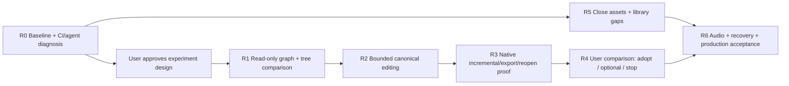

# Studio Graph Evaluation and Remaining Production Roadmap

> **For agentic workers:** use superpowers:executing-plans or superpowers:subagent-driven-development for the authorized phase-by-phase implementation. Checkbox completion requires actual evidence; human/default/release gates remain separate.

**Goal:** choose the least complex editor that makes scene relationships understandable while preserving measured timing, canonical ownership and recoverable production.
**Design/audit:** [independent evaluation and schema](../specs/2026-11-24-studio-graph-evaluation-design.md).
**Status:** SUPERSEDED 2026-11-25 by [studio-production-graph](2026-11-25-studio-production-graph.md) (per-scene relationship graph dropped; ComfyUI-style production-flow graph instead). Original text: Phase-by-phase implementation authorized by user on 2026-11-24. R0 IN PROGRESS; later phases remain gated by their dependencies and genuine human acceptance. This roadmap supplements the [original P0–P7 contract](2026-11-14-unified-zodiac-studio-roadmap.md); it does not erase pending requirements or reopen technically accepted foundations without evidence.

## Existing phase ledger

| Original phase | Evidence-backed position | Remaining / acceptance work | New lane |
| --- | --- | --- | --- |
| P0 core | Implemented; dated core/import/revision tests in original roadmap | Rerun affected import/identity/source integrity regressions; full current latency baseline still absent | R0, R3 |
| P1 shell/agent | Implemented; grouped UI/native task receipts; titlebar browser verification | Fresh uninterrupted agent authoring/apply reliability; latest remote CI unknown; cold native startup/resource baseline; inspect retained task failure/retry | R0, R3 |
| P2 voice/timing | TTS/ASR, selected takes, waveform and technical playback available | Human listening pending; fresh run acceptance separately from reused voice; keep narration/timing hashes | R0, R3, R6 |
| P3 compiler | Technical acceptance; geometry/scene/appearance cache already exists | Measure actual invalidation fan-out and no-op/warm edits; do not replace DAG with GUI graph | R0, R3 |
| P4 editor | Technical editing, timeline, preview/export/reopen receipts | Compare new relationship UX; untouched fields and stale-source behavior; human visual review | R1–R4 |
| P5 assets | Gallery, candidate constraints, phone masters, palette candidates, acting command, source-byte usage implemented in bounded slices | >=3 genuinely reviewed palettes incl dark; 3 reviewed phone geometries with grips/contact; complete meme/component previews; character quality; reviewed/model-level history beyond exact-byte technical usage, bounded scan coverage | R5 |
| P6 concepts/library/audio/packages | Ideas catalog ×12 and MP4 concept review partly implemented; project registry/status present | Source-bound visual/final review status linkage; full library dedup/media lineage; licensed audio catalog/audition/cues; archive+restore and historical package coverage | R5, R6 |
| P7 export/retirement | Real HyperFrames H.264/AAC export, decode, sidecars, restart technically verified | Fresh uninterrupted E2E, human whole-video quality, Audio Mix V2/rights receipt when used; legacy compatibility/retirement gate, resources/retry/cancel. Voice-only export remains valid for current technical flow | R3, R6 |

Evidence: original roadmap header; `2026-11-18-studio-phase-05.md`; `2026-11-19-studio-p5-usage-progress.md`; `2026-11-22-studio-workflow-agent-e2e.md`; `2026-11-24-studio-workbench-evidence.json`; `2026-11-24-studio-titlebar-performance.md` under docs/audits. Historical PASS is not rerun-current PASS. No phase is promoted by this planning task.

## Dependency order

R5/R6 domain work must remain usable through the existing editor if Graph is rejected. An eight-scene prototype is not permission to postpone agent/CI repairs or drop P5–P7.

## R0 — Reproducible baseline and blockers (IN PROGRESS)

R0.1 CI repair: local verification PASS; remote verification pending. [Evidence](../../audits/2026-11-24-studio-graph-r0-ci.md). The phase is not complete: copied fixture, native baseline, fresh agent and current remote CI remain required.

**Outcome:** reliable comparison base, exact CI/agent blockers and copied episode manifest. No Graph dependency yet.
**Files:** existing `.github/workflows/studio-v5-tauri-p1.yml`, `tools/studio_project/agent_bridge.py`, `agent_authoring.py`, affected existing tests only if an observed bug requires repair; new dated audit JSON/Markdown. Keep repairs in scoped commits, no broad agent rewrite.

- [ ] Retrieve push workflow/check-run jobs/logs for exact HEAD and last failed relevant run. Connector PR-only empty results do not count as green. Identify first actual failure and fix its cause; immediately propagate P2 discover exit status. Register affected browser checks/path filters, including `tests/studio_episode_timeline.test.mjs` and new graph tests when introduced; verify browser provisioning and fixtures in CI.
- [ ] Pin original Nhân Mã source identity, imported handoff, project ID, source/voice/timing/build/export hashes. Create isolated consistent project copy using existing supported service/import behavior; verify original bytes before/after and reopen copied registry identity. Stop on missing media/rights rather than invent replacements.
- [ ] Record current editor cold startup, selected-project RPC timing, idle memory, SDK load, warm no-op build, single-scene transform/event edits, whole export and reopen. Store raw samples and configuration; no invented ETA.
- [ ] Reproduce fresh initial agent attempt with frozen model/config, preserve validation attempts. Verify malformed role/anchor/asset response rejects before apply; stale source/voice revision rejects; cancelled/restarted task cannot apply. Record uninterrupted result separately from manual recovery and reused voice.
- [ ] Required checks: existing focused Project Core, authoring/binding, P2, P3/P4 and export regressions for touched code; `pnpm.cmd -C apps/zodiac-studio build`; native smoke; current remote CI. Close only observed blockers, record genuine human gates pending. Commit/push scoped fixes and evidence.

Gate: reproducible fixture and trustworthy checks. Remote failure blocks promotion; unrelated failure gets exact owner/reason, not silently ignored. User authorized phase-by-phase implementation on 2026-11-24; prototype work still waits for this R0 gate.

## R1 — Read-only relationship prototype and cheaper comparison

**Outcome:** optional scene graph rendered from source with persistent preview, same project selection, Timeline and linear structure alternative.
**Proposed files:** create `apps/zodiac-studio/src/scene-graph.ts` (pure projection), `SceneGraph.tsx` (lazy React Flow surface); modify `VisualEditor.tsx`, `workbench-state.ts`, `style.css`, package/lock only after dependency approval. Create `tests/studio_scene_graph.test.mjs`, `tests/studio_graph_browser.mjs` using existing fixture transport. Avoid a second playback controller or Graph backend.
**Interfaces proposed:** `projectSceneGraph(input: { projectId: string; visual: VisualState; voice: VoiceState|null; sceneId: string|null }): GraphView`; GraphView carries sourceRevision/sourceHash plus readonly nodes/edges/diagnostics defined in the design. Selection extends WorkbenchSelection with nullable state/event/anchor IDs. UI layout store never becomes a canonical command payload.

- [ ] Projection test cases: deterministic IDs across scene reorder; equal labels with different references remain distinct; sparse scene/no events; missing assets/cast/anchor diagnostics; duplicate anchor text; unknown fields survive because projector never writes Intent. Freeze input and assert no mutation.
- [ ] Confirm @xyflow/react version peer compatibility/license and install a pinned version in the approved spike. Implement columns, scene group expansion, entity variants, state/event/anchor references and explicit edge labels; no arbitrary connections, no pose/expression editors yet.
- [ ] Wire graph selection to existing preview/time/Inspector. Add linear structure mode for keyboard use and cheaper comparison; no graph state in Python. Drag/pan/collapse must produce zero canonical writes/builds and retain source hash/revision after reload.
- [ ] Run pure projection test, graph browser fixture at 1366x768 / 1060x650 / 1093x614, TypeScript/Vite. Capture screenshots and incremental bundle cost; preview >=190px tall, visible focus and all controls reachable.
- [ ] Commit/push evidence. Gate: read-only integrity passes and user can inspect both structures; no default switch.

## R2 — Existing commands only, confirmed edits

**Outcome:** node selection → existing canonical edit → refreshed projection and truthful preview.
**Files:** `VisualEditor.tsx`, `SceneGraph.tsx`, `scene-graph.ts`, existing backend adapter; extend existing visual workspace/agent tests only where mapping needs coverage. Do not create generic graph.write RPC.
**Interface:** Inspector dispatches `backend.visualCommand(projectId, base_revision, kind, payload, command_id)` and consumes returned VisualState; Agent continues existing apply path. Exact payload shapes remain those in `VisualWorkspace.command`, not React Flow node data.

- [ ] Add tests for graph node target → allowed scene.patch; scene.performance replaces only that scene's full event list; asset.select uses newly validated candidate. Verify stale revision, changed voice, dangling references, contact-bound transforms, invalid state chain and out-of-scene anchor fail without source mutation.
- [ ] Implement only matrix actions in the design. Clear/disable stale preview while source differs; show build freshness. Graph coordinates never map to video x/y. Keep canonical undo/redo and refresh after accepted edit/rejected optimistic change.
- [ ] Test scene/entity/state selection continuity, source unknown fields preserved, undo/redo restores source and projection, cancelled Agent proposal applies nothing, confirmed application does not change approval. Reuse existing validators and failure feedback.
- [ ] Run graph tests, `python -m unittest tests.test_studio_agent_authoring -q`, affected `test_studio_p34_*.py` and `test_studio_p5_*.py` discovery, build and native command smoke. Record exact commands/results. Commit/push.

Gate: no broadened writing authority. Granular pose/expression/contact additions require a separate approved contract/task after this slice; source.replace is not their hidden fallback.

## R3 — Incremental build → MP4 → reopen

**Outcome:** native Tauri/Rust/Python proof using copied real eight-scene episode.
**Files:** existing `tests/studio_workbench_browser.mjs`, graph browser test, `tests/studio_p34_visual.test.mjs`, Python workspace/export tests; compiler/Core edits only if cache evidence shows a defect. New dated evidence JSON with phase timings, source hashes, cache nodes and output lineage; media stays local.

- [ ] Establish warm no-op cache result; perform one allowed unbound transform, then one valid event change. Record actual rebuilt/reused node IDs and output hashes. Compare cache fan-out with equivalent Timeline/Inspector operation. Shared cast/theme edits may legitimately fan out; do not force scene-only invalidation where dependencies are global.
- [ ] Use episode.build for current full manifest/export; verify all eight scenes covered even if most computations reuse cache. Assert unchanged voice/narration/timing bytes, consistent current build revision/source and no write to original project.
- [ ] Export actual HyperFrames MP4, probe/full decode, verify source-bound sidecars/cover/audio identity, inspect state/event and caption boundary frames. Close/reopen native app; prove exact export hash, canonical edit history and graph selection/layout reconciliation. Retry/cancel/stale export and lost backend must preserve last healthy output.
- [ ] Run affected existing regressions, build and current remote CI. Keep native times separate from fixture tests and human review. Commit/push receipt.

Gate: reproducible integrity and performance data; no claim of partial MP4 rerender unless independently implemented/proven.

## R4 — User comparison and default decision

- [ ] Run A/B/C tasks from design on identical episode baseline; counterbalance order and collect task time, clicks, errors, comprehension, subjective preference and actual machine resource measurements. A can remain a bounded scene-expanded presentation, not a new backend.
- [ ] Evaluate proposed performance/usability thresholds in design. Publish raw samples and failures, not just averages. User reviews real interface and video; fixture success is not acceptance.
- [ ] Choose: retain current/tree editor; keep Graph optional; or approve default Graph. A default switch requires explicit user acceptance and justified benefit, plus fallback/reopen tested. Commit/push decision record; remove abandoned prototype only through a scoped reviewable change.

## R5 — Finish P5 and P6 library foundations (separate detailed plan)

- [ ] Audit gallery coverage against canonical asset capability inventory; implement missing complete meme previews and necessary contact/character quality fixes. Present >=3 palettes including dark and three truly distinct phones in source-bound scenes for genuine review. Do not inflate palette count to eight by requirement.
- [ ] Model-level/ reviewed usage requires real reviewed-source receipts; exact-byte technical history remains visibly distinct. Verify bounded scan/truncation and model identity. No graph DB or copied asset catalog.
- [ ] Link episode/content/voice/visual/video status to explicit source-bound receipts, retain concept×sign progress, distinguish exported and published; deduplicate library identity and verify archive/restore before claiming P6 complete. Never reinterpret historical MP4 checkboxes as visual source approval.

Gate: requirements-to-evidence rows for every remaining P5/P6. User acceptance rows stay pending until supplied. This lane may use existing editor regardless of Graph choice.

## R6 — Audio, recoverability and production quality (separate detailed plan)

- [ ] Licensed local audio catalog, missing-file/rights SHA states and audition; optional event-bound cues and voice-first Audio Mix V2. Preserve current valid voice-only export; mixing alone must avoid TTS/ASR/geometry/video-only recomputation. Existing compiler rejects authored audio-mix fields today: add explicit separate validated audio owner/contract, not a hidden Graph field.
- [ ] Archive/reopen/cancel/retry/last healthy source/export and old Job@5/Remotion compatibility; provide old/new production evidence. Keep legacy support until retirement explicitly authorized.
- [ ] Fresh uninterrupted import→TTS/ASR→agent proposal/confirmed apply→edit→preview→export→restart with raw provenance, resources, rights and source/caption/audio/video checks. Genuine listening, visual and final-video acceptance closes respective gates; technical MP4 alone does not.

Gate: P5/P6/P7 acceptance ledger complete. Installer/release/publication/production merge still requires separate authorization.

## Review focus and boundaries

Highest-risk cases: graph layout accidentally writes source; duplicated IDs/anchor text targets wrong state; shared-cast edit under-invalidates cache; stale agent or preview masks changed source; source-bound approval is lost/promoted on reopen. Each is covered in R1/R2/R3 tests and R5 review ownership.

Approval sequence: user chooses experimental approach/design → authorize R0/R1 detailed execution → bounded prototype → proof → default decision. R5/R6 need their own current-contract detailed plans at readiness, not invented API signatures now. No product code or dependencies were changed during this planning task.
