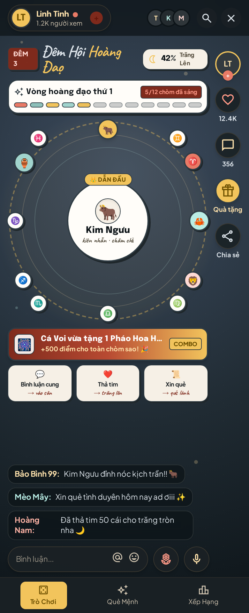
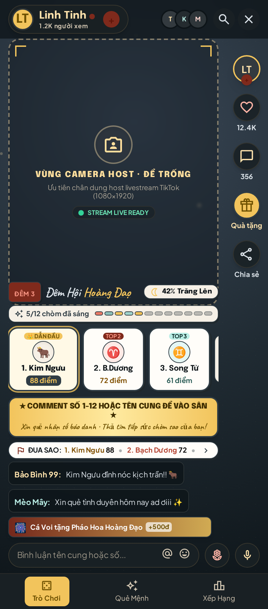
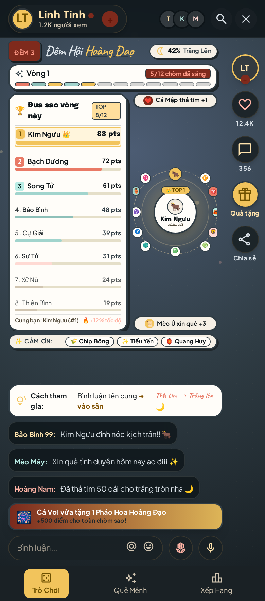
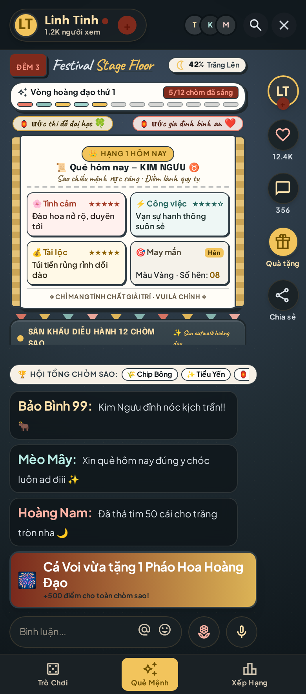
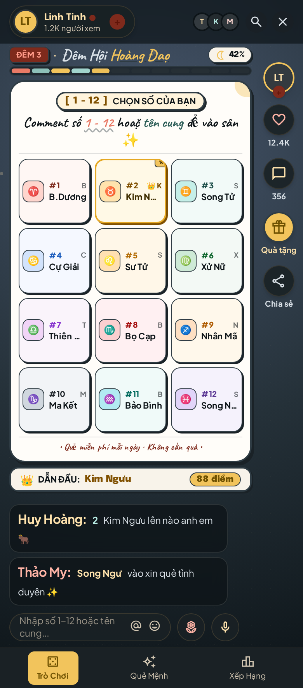

> **Lưu trữ thiết kế cũ, không phải các bản đang vận hành.** Hiện chỉ dùng một overlay tại `/`, cùng giao diện cho LIVE và simulator. Diễn tập tại `http://127.0.0.1:4850/simulator`; không mở thêm cổng để chọn bố cục. `lite` chỉ giảm hiệu ứng; `phone` là tương thích khung cao, không phải phiên bản gameplay khác. Các hướng dẫn 12 cung dưới đây đã cũ.

# 5 biến thể bố cục khung live 1080×1920

Bản dựng Stitch: **https://stitch.withgoogle.com/projects/9979531318077856580**
Ảnh: `docs/previews/livestream-variants/` (780×1768 mỗi ảnh).

Cùng một bộ nội dung (trăng, vòng hoàng đạo, đua sao, quẻ, câu đố), khác nhau ở chỗ **đặt gì ở đâu**. Chọn theo kiểu buổi live; luật chơi không đổi.

> **Đang dựng:** `overlay.html` theo bố cục **C** rút gọn, giao diện giấy cũ, chưa tính vùng an toàn: thẻ trên cùng gộp (tên đêm, trăng, mục tiêu, top 3 xếp hạng), bánh xe full chiều ngang với vòng tròn giữa 580px làm sân khấu, thẻ sự kiện 150px, thẻ dưới gộp (Quà chung + quà gần đây + Cách chơi). Chưa ai vào sân thì bánh xe được thay bằng **Sảnh chờ** (chào + hàng đợi 8 chỗ + 12 ô cung); linh vật chỉ hiện khi cung đó đã có người chọn.

> **Đọc ảnh cho đúng.** Ảnh là khung 780×1768 (≈9:20). Phần dưới cùng mỗi ảnh — khung bình luận, ô "Bình luận...", thanh tab — là **của TikTok**, overlay của mình không vẽ phần đó. Toàn bộ nội dung game nằm trong 0–75% chiều cao. Vùng ảnh dưới đây ghi theo % chiều cao khung 1920.

---

## Vùng an toàn (chung cho cả 5)

| Vùng | Trên khung 1080×1920 | Quy ra % |
|---|---|---|
| Tên kênh + số người xem | y 0–130 | 0–7% |
| Cột nút phải (avatar, tim, bình luận, quà, chia sẻ) | x 930–1080 | — |
| Khung bình luận + banner quà | y 1440–1920 | 75–100% |

Bảng trên là ghi chú lúc thiết kế 5 biến thể. Bố cục hiện tại đã tự chừa vùng bình luận của TikTok (mọi thứ cần đọc nằm trên y≈1200, phía dưới là Bầu trời cộng đồng), nên `?safe=1` trong các phần Setup bên dưới không còn tác dụng; `&guides` vẫn bị bỏ qua.

---

## A · Wheel Stage — bánh xe là nhân vật chính

`screen a84ce88d43c349c29adee8ed1f0f0aea`

| % | Nội dung |
|---|---|
| 7–12 | "ĐÊM 3" + tiêu đề + pill trăng 42% |
| 14–18 | Vòng hoàng đạo thứ 1 · 5/12 chòm đã sáng · 12 vạch |
| 19–53 | Bánh xe 12 cung, thẻ giữa: Kim Ngưu · kiên nhẫn |
| 55–59 | Banner quà (Pháo Hoa +500 điểm) |
| 60–66 | 3 thẻ cách chơi: Bình luận cung → vào sân · Thả tim → trăng lên · Xin quẻ → quẻ lành |

**Dùng khi:** buổi bình thường, phòng vừa–đông, không có camera.
**Setup:** Browser Source 1080×1920, `?safe=1`. Đây là bố cục gần nhất với `overlay.html` hiện tại — chỉ cần bỏ bảng "Đua sao" và dải "Cảm ơn", thay bằng 3 thẻ cách chơi.
**Đánh đổi:** không thấy bảng xếp hạng 12 cung; ai muốn biết mình hạng mấy phải chờ thông báo.

---

## B · Host First — camera host là nhân vật chính

`screen 63e5739a764a4d81b29c0349b22010bf`

| % | Nội dung |
|---|---|
| 6–45 | VÙNG CAMERA HOST · ĐỂ TRỐNG (viền nét đứt, nhãn "STREAM LIVE READY") |
| 46–50 | Tiêu đề + pill trăng + vạch 12 cung |
| 53–62 | 3 thẻ hạng 1–2–3 (Kim Ngưu 88 · B.Dương 72 · Song Tử 61) |
| 63–69 | Dải CTA vàng: "Comment số 1–12 hoặc tên cung để vào sân" |
| 70–72 | 1 dòng: Đua sao · 1 Kim Ngưu 88 · 2 Bạch Dương 72 › |

**Dùng khi:** host ngồi nói với camera (kể chuyện cung, bói trực tiếp). Overlay chỉ viền quanh, không che mặt.
**Setup:**
1. OBS: nguồn **Video Capture** ở dưới, **Browser Source** ở trên.
2. `?safe=1&transparent=1` để thấy camera qua nền.
3. Canh mặt host trong dải 6–45%; bật `&guides=1` một lần rồi bỏ.
**Đánh đổi:** mất bánh xe và bảng đua đầy đủ — chỉ còn top 3. Hợp buổi nói nhiều, không hợp buổi "treo màn hình chờ".

---

## C · Split Dashboard — bảng đua luôn hiện

`screen a883e659b6a14088bbc3ce94f4753cfc`

| % | Nội dung |
|---|---|
| 15–54 | **Cột trái:** Đua sao vòng này — 8 dòng (hạng, tên cung, thanh, điểm) + chân "Cung bạn: Kim Ngưu (#1) +12% tốc độ" |
| 15–18 | Toast "Cá Mập thả tim +1" (phải) |
| 25–43 | **Cột phải:** bánh xe thu nhỏ, giữa là TOP 1 Kim Ngưu |
| 44 | Toast "Mèo Ú xin quẻ +3" |
| 55 | Dải Cảm ơn (Chip Bông · Tiểu Yến · Quang Huy) |
| 62–67 | Thẻ "Cách tham gia" 1 dòng |

**Dùng khi:** phòng rất đông, cần bảng xếp hạng đọc được liên tục; buổi PK/đua sao.
**Setup:** Browser Source 1080×1920, `?safe=1`. Cột trái phải dừng trước x 930 để không chui dưới nút TikTok.
**Đánh đổi:** bánh xe nhỏ ~40%, mascot khó nhìn. Bù lại bảng đua đọc được từ xa. Ảnh mẫu chỉ hiện 8/12 dòng — khi dựng thật phải cuộn hoặc thu gọn còn 8 dòng + "…4 cung còn lại".

---

## D · Festival Stage — sân khấu, ít bảng biểu

`screen 566e975d101a4631ba54e56a3eb7962d`

| % | Nội dung |
|---|---|
| 7–12 | Tiêu đề + pill trăng + vạch 12 cung |
| 14–16 | 2 đèn ước bay lên ("ước thi đỗ đại học", "ước gia đình bình an") |
| 19–45 | Tờ quẻ lớn: Hạng 1 hôm nay · Quẻ hôm nay — Kim Ngưu · 4 mục (tình cảm, công việc, tài lộc, may mắn) · màu vàng · số hên 08 · "chỉ mang tính giải trí" |
| 45–50 | Dải sân khấu: SÀN KHẤU DIỄU HÀNH 12 CHÒM SAO (12 linh vật đứng thành hàng) |
| 51–54 | Dải Cảm ơn |

**Dùng khi:** buổi có nhịp cảm xúc — lúc chiếu quẻ, lúc ăn mừng, lúc kể chuyện. Phòng vừa, nhiều người xem mới.
**Setup:**
1. Sàn + 12 linh vật vẽ vào canvas `#bg` (không phải HTML) để giữ 30fps.
2. Tờ quẻ dùng lại modal `#fortune` hiện có, chỉ đổi vị trí sang giữa khung.
3. Bỏ bảng "Đua sao"/"Cách tham gia"; xếp hạng chỉ còn trong dải sân khấu.
**Đánh đổi:** ít thông tin nhất. Người xem mới không biết cách chơi nếu không có dòng CTA — phải giữ 1 dòng "Comment tên cung để vào sân" đâu đó. Ảnh mẫu đang thiếu dòng đó.

---

## E · Minimal Onboarding — 30 giây đầu, phòng vắng

`screen 22a219bfb6a84dba955e531a21519c72`

| % | Nội dung |
|---|---|
| 7–12 | Tiêu đề + pill trăng 42% + vạch 12 cung |
| 12–65 | 1 thẻ lớn: "[1–12] CHỌN SỐ CỦA BẠN" · "Comment số 1–12 hoặc tên cung để vào sân" · lưới 3×4 ghi 12 cung (#1–#12, ký hiệu + tên) · "Quẻ miễn phí mỗi ngày · không cần quà" |
| 66–69 | 1 dòng: DẪN ĐẦU: Kim Ngưu · 88 điểm |

**Dùng khi:** mở sóng, phòng 0–5 người; hoặc làm màn "chờ" trước khi vào game.
**Setup:** Browser Source 1080×1920, `?safe=1&transparent=1` nếu đặt trên camera. Không bảng đua, không toast.
**Đánh đổi:** chỉ hợp lúc mở sóng. Phòng đã đông mà vẫn để sẽ trông trống — phải chuyển sang A hoặc C.
**Lỗi cần sửa khi dựng thật:** tên cung bị cắt ("Kim N…", "Thiên …", "Song N…") vì có thêm cột chữ cái. Bỏ cột chữ cái, chỉ giữ ký hiệu + tên đầy đủ.

---

## Chọn nhanh

| | Nội dung | Hợp phòng | Cần camera | Bảng đua đầy đủ |
|---|---|---|---|---|
| A Wheel Stage | vừa | vừa–đông | không | không |
| B Host First | mỏng | vừa–đông | **có** | top 3 |
| C Split Dashboard | dày | rất đông | không | **có** |
| D Festival Stage | vừa | vừa | không | 1 dải |
| E Minimal | rất mỏng | vắng | tuỳ | không |

## Bố cục nào cũng phải giữ

- Không đặt chữ hay nút trong cột nút phải (x 930–1080) và khung bình luận (y 1440–1920).
- Chữ quan trọng (tên cung, điểm, CTA) ≥ 26px trên khung 1080; dưới mức đó không đọc được trên điện thoại.
- Hiệu ứng đi qua `#fx`; không dùng `filter`/`backdrop-filter` — tụt fps khi live.
- Không có tên người xem giả trên sóng.
